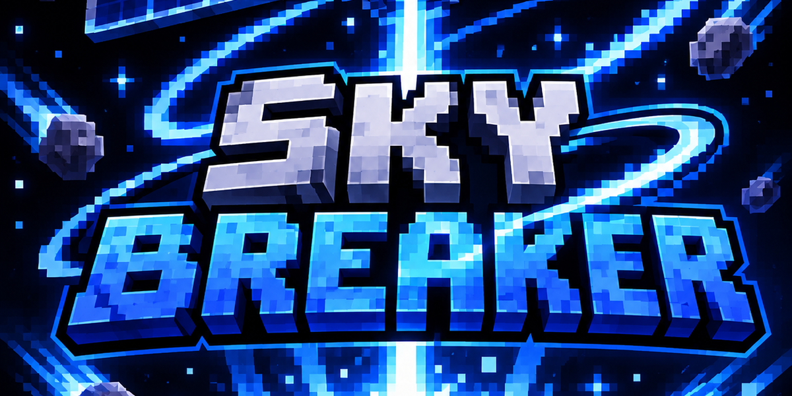

<p align="center">
  
</p>

<h1 align="center">Skybreaker: Orbital Arsenal</h1>

<p align="center">
  <b>Call down the sky.</b> Eight orbital strike remotes for Minecraft (Fabric) with cinematic cameras, slow-motion impacts, custom sounds and a fully configurable arsenal.
</p>

<p align="center">
  <a href="https://github.com/KiegsGit/SkyBreaker-v3-BETA-/releases/latest"></a>
  
  
  
</p>

---

## Install

1. Install [Fabric Loader](https://fabricmc.net/use/) for **Minecraft 26.3** (Java 25).
2. Download [Fabric API](https://modrinth.com/mod/fabric-api) and put it in your `mods` folder.
3. Download `skybreaker-26.3.jar` from the [latest release](https://github.com/KiegsGit/SkyBreaker-v3-BETA-/releases/latest) and drop it in the same `mods` folder.
4. Launch the game. The config is generated at `config/skybreaker.json`.

> Works in singleplayer and on servers. Install it on the server **and** on every client that should see the effects.

## How to use

1. Craft or `/give` yourself a remote (see below).
2. Hold it and **aim at a block** (up to 128 blocks away). A targeting reticle shows where it will land.
3. **Right-click** to fire. A short countdown plays, then the strike lands.
4. The remote goes on cooldown. Hold a **Targeting Chip** in your off-hand to recharge **40% faster**.

The **Tracking Strike** is different: aim at a **mob or player** to lock on. It follows them and strikes where they end up.

## The arsenal

| Item | What it does | Cooldown | Recipe |
|---|---|---|---|
| **Orbital Railgun** | A tungsten rod dropped from orbit. Pinpoint hit, huge crater. | 20s | Diamond Block, Lightning Rod, Netherite Ingot, Beacon |
| **Satellite Laser** | A beam burns a path for seconds, then ends in a massive detonation. | 30s | Netherite Ingot, End Crystal, Diamond Block, Nether Star |
| **Meteor Barrage** | Rains meteors over a wide area. | 40s | Fire Charge, Magma Block, Netherite Scrap, Ender Pearl |
| **Singularity Cannon** | Opens a black hole that drags in blocks and mobs, then collapses in a giant blast. | 60s | Crying Obsidian, Echo Shard, Ender Eye, Nether Star |
| **EMP Pulse** | Freezes mobs, blacks out lamps and torches, wrecks redstone. | 25s | Redstone Block, Lightning Rod, Netherite Ingot |
| **Orbital Napalm** | Thermite rain, then a field of fire that burns everything inside. | 40s | Fire Charge, Lava Bucket, Netherite Ingot |
| **Tactical Nuke** | Long countdown, giant blast, mushroom cloud. **Stay far away.** | 120s | TNT, Netherite Block, Beacon |
| **Tracking Strike** | Locks onto a mob or player and strikes where they end up. | 20s | Ender Eye, Spyglass, Netherite Ingot |
| **Targeting Chip** | Hold in the other hand: remotes recharge 40% faster. | n/a | Redstone, Diamond, Ender Eye |

All remotes are in the **Combat** creative tab. Cooldowns above are the defaults and can be changed in the config.

## Commands

Skybreaker has no custom commands. Everything is done with the items, so use vanilla commands to grab them (needs cheats / operator):

```mcfunction
/give @s skybreaker:orbital_railgun
/give @s skybreaker:satellite_laser
/give @s skybreaker:meteor_barrage
/give @s skybreaker:black_hole
/give @s skybreaker:emp_pulse
/give @s skybreaker:orbital_napalm
/give @s skybreaker:tactical_nuke
/give @s skybreaker:tracking_strike
/give @s skybreaker:targeting_chip
```

Handy extra: `/recipe give @s *` unlocks every recipe so you can see them in the recipe book.

## Configuration

Edit `config/skybreaker.json`, then restart the game or server. Missing keys are filled in with defaults. Every weapon has its own cooldown, countdown, radius and damage.

| Option | Default | What it does |
|---|---|---|
| `terrainDestruction` | `true` | **Master switch.** `false` means no block is ever destroyed by any weapon. |
| `maxBlocksPerStrike` | `6000` | Cap on blocks one strike can remove. |
| `maxBlockHardness` | `50` | Blocks harder than this (obsidian = 50) survive. Bedrock always survives. |
| `protectBlockEntities` | `true` | Chests, spawners, beacons and other data blocks are never destroyed. |
| `maxTargetRange` | `128` | Aiming distance (hard cap 128). |
| `damagePlayers` / `damageOwner` | `true` / `false` | Whether strikes hurt players, and whether they hurt you. |
| `cinematic` / `cinematicCamera` | `true` | Intro cutscene and camera easing toward the target. |
| `slowMotion` | `true` | Bullet-time at impact (only when one player is on the server). |
| `lightning`, `debris`, `cameraShake` | `true` | Extra visual effects. |
| `particleScale` | `1.0` | Lower to `0.2` for a quick FPS boost on weaker PCs. |

Per-weapon keys follow the pattern `railgunCooldownSeconds`, `nukeBlastRadius`, `laserDurationSeconds`, `meteorCount`, `blackHolePullRadius` and so on. Open the generated file to see all of them.

**Safe mode for servers:** set `"terrainDestruction": false` and `"damagePlayers": false` to keep the show without the grief.

## Performance tips

- Lower `particleScale` (e.g. `0.5`).
- Set `debrisCount` to `0` or a small number.
- Turn off `cinematicCamera` and `slowMotion` if you get motion sick.

## Building from source

```bash
git clone https://github.com/KiegsGit/SkyBreaker-v3-BETA-.git
cd SkyBreaker-v3-BETA-
./gradlew build
```

The jar appears in `build/libs/`. Requires JDK 25. Every push also builds automatically with GitHub Actions and updates the **latest** release.

## Warning

These weapons are **extremely destructive**. Back up your world first, and be careful on shared servers.

## License

MIT, see [LICENSE](LICENSE).
